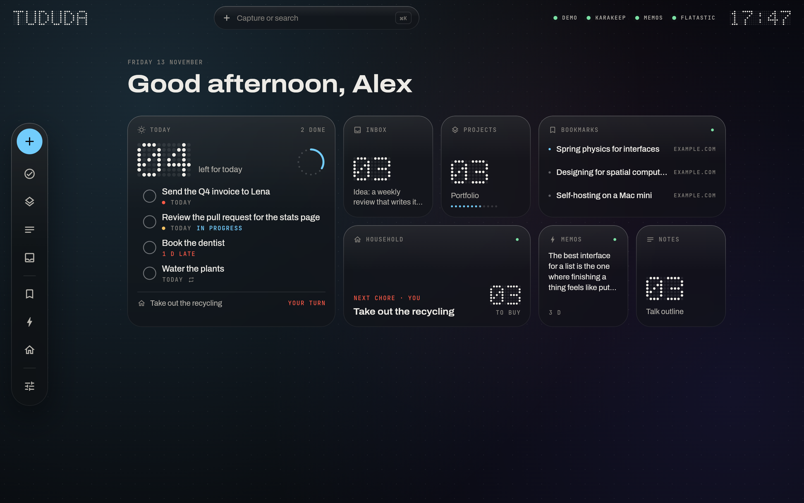
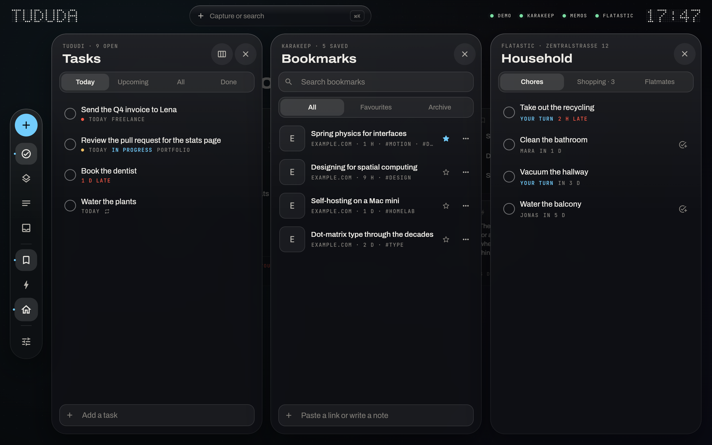
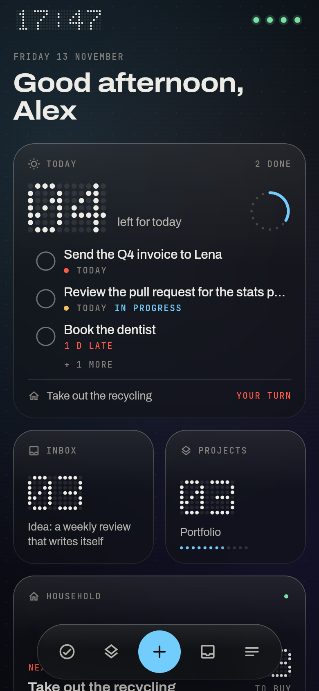

<div align="center">

# 📱 Tududa


<br>
<small><em>App icon generated by AI</em></small>

**A spatial client for [Tududi](https://github.com/chrisvel/tududi), with Karakeep, Memos and Flatastic beside it**

*A calm, open system for organizing life and work.*

[](https://flutter.dev)
[](https://dart.dev)
[](LICENSE)
[](#-vibe-coding)

**English** | [中文](README_CN.md)

</div>

---

## ⚠️ Disclaimer

**This is a third-party mobile client.** Tududa is not affiliated with, endorsed by, or connected to the original Tududi project.

The original [Tududi](https://github.com/chrisvel/tududi) is created and maintained by **[Chris Veleris](https://github.com/chrisvel)** — a self-hosted task management system built with Node.js and React. All backend APIs and server-side logic belong to the original project, licensed under the [MIT License](https://github.com/chrisvel/tududi/blob/main/LICENSE).

This Flutter client is an independent, community-driven effort to bring the Tududi experience to Android, iOS, the web and the desktop. It is equally unaffiliated with [Karakeep](https://karakeep.app), [Memos](https://usememos.com) and Flatastic.

---

## 🎵 Vibe Coding

This project is entirely **vibe coded** — built through human-AI pair programming sessions using conversational prompts. No line of code was manually typed in the traditional sense; instead, every feature, fix, and design decision emerged from natural language conversations with AI coding assistants.

> *"Describe what you want, and let the code flow."*

---

## ✨ What it is

Tududa 2 is a spatial home for a self-hosted life: **Tududi** at the centre, with **Karakeep**, **Memos** and **Flatastic** connected live beside it. One codebase for Android, iOS, the web and the desktop, with a layout of its own for phones and for wide screens.

- **The wall** — home is a wall of glass cards, one per part of the system, each showing what matters there now: what is left today, the inbox count, the next chore, the latest bookmarks.
- **Windows** — a card opens into a window that grows out of it on springs and shrinks back when closed. On a phone it fills the screen and can be dragged down to dismiss; on a wide screen up to three stand side by side.
- **Capture** — one field for everything (`⌘K` / `Ctrl K`, or the round button). A link is offered to Karakeep, "buy oat milk" to the Flatastic shopping list, a paragraph to Memos, anything else becomes a task. The same field searches what is already there.
- **Tasks** — Today / Upcoming / All / Done, a kanban board with drag between statuses, steps, due dates, priorities, projects and recurrence. Checking a task is optimistic, animated and undoable.
- **Projects, areas, notes, inbox** — everything Tududi offers, with Markdown notes that save when you leave them.
- **Bookmarks (Karakeep)** — search, favourite, archive, add a link or a note, turn a bookmark into a task.
- **Memos** — a stream of quick notes; write, pin, edit, turn one into a task.
- **Household (Flatastic)** — whose turn each chore is, the shared shopping list, the points table.
- **Live** — everything is fetched again every minute and when the app comes back to the front; a lamp per service in the status bar shows its state.
- **Languages** — English, Deutsch, 中文.
- **Demo** — "Look around with sample data" on the sign-in screen, or `?demo` on the web build, runs the whole thing on sample data without a server.

### The look

Dark, one accent, hairlines; frosted glass panes over a slow field of light; readouts (the clock, counts) on a dot matrix of its own; Archivo and JetBrains Mono, bundled. Motion is physical: springs that keep their velocity, things that give under a press and lean toward a pointer. "Reduce motion" (the system's setting or the app's) turns it all into changes in place.

---

## 📸 Screenshots

| Home (desktop) | Windows side by side | Home (phone) |
|---|---|---|
|  |  |  |

*Demo data.*

---

## 🔌 Connecting the services

All of it is in **Settings → Connections**.

| Service | What you need | Notes |
|---|---|---|
| Tududi | Server address, email, password | Session cookie, as before |
| Karakeep | Address and an API key (Settings → API Keys) | REST API `/api/v1` |
| Memos | Address and an access token (Settings → My Account → Access Tokens) | REST API `/api/v1`, Memos 0.22 or newer |
| Flatastic | Your Flatastic email and password, or an API key | **Unofficial.** Flatastic publishes no API; Tududa talks to the one its own apps use, which can change without notice. Reading the flat, chores and shopping list follows a known client; signing in and writing (chore done, add / tick / delete an item) are best effort and untested against the live service |

Keys are kept in the platform's keychain (preferences where there is none).

**On the web** the browser decides which servers the page may talk to: your Tududi, Karakeep and Memos must allow the page's origin (CORS, with credentials for Tududi), or sit behind the same reverse proxy. The native apps have no such limit.

---

## 🛠️ Tech Stack

| Category | Technology |
|---|---|
| **Framework** | Flutter 3.41+ / Dart 3.11+ |
| **State** | Riverpod |
| **Networking** | Dio + Cookie Manager |
| **Storage** | SharedPreferences, FlutterSecureStorage |
| **UI** | Custom kit (`lib/os/kit`), Flutter Markdown |

---

## 📦 Project Structure

```
lib/
├── main.dart          # boot: auth check, theme, the shell or sign-in
├── os/                # the interface
│   ├── kit/           # tokens, springs, glass, dot matrix, controls, backdrop
│   ├── shell.dart     # the room: wall, windows, status bar, dock, toasts
│   ├── window.dart    # a window's frame and physics, the app pane, rows
│   ├── wall.dart      # the home cards
│   ├── capture.dart   # the capture / search bar (rules in capture_logic.dart)
│   ├── onboarding.dart
│   ├── l10n.dart      # tr(); German and Chinese in l10n_table.dart
│   └── apps/          # tasks, task_sheet, projects, notes, inbox,
│                      # karakeep, memos, flat, settings
├── data/
│   ├── tududi.dart    # tasks, projects, areas, notes, inbox (optimistic)
│   ├── links.dart     # Karakeep, Memos, Flatastic clients and state
│   ├── demo.dart      # sample data
│   ├── prefs.dart     # accent, language, reduce motion
│   └── session.dart   # sync everything, reset on sign-out
├── auth/              # session and user model
├── core/              # ApiService (Dio client for Tududi)
└── */models/          # Tududi's models
```

Tests: `flutter test` (rules in `test/logic_test.dart`, the shell on a phone and a desktop size in `test/os_test.dart`).

---

## 🚀 Getting Started

### Prerequisites

- [Flutter SDK](https://docs.flutter.dev/get-started/install) 3.x+
- A running [Tududi](https://github.com/chrisvel/tududi) server instance
- Android Studio / Xcode (for platform builds)

### Setup

```bash
# Clone the repository
git clone https://github.com/LawrenZzz/tududa.git
cd tududa

# Install dependencies
flutter pub get

# Run in development mode (a phone, or a desktop: -d macos / -d linux / -d windows)
flutter run

# Or in a browser; add ?demo to the address to open on sample data
flutter run -d chrome
```

### Configure Server

On the login screen, enter your Tududi server URL (e.g., `http://your-server:3002`) along with your credentials.

### Build Release APK

```bash
# Android
flutter build apk --release

# iOS
flutter build ios --release
```

---

## 🔧 Server Compatibility

This client is designed for the [Tududi](https://github.com/chrisvel/tududi) backend. Key API characteristics:

| Operation | Method | Endpoint |
|---|---|---|
| List tasks | `GET` | `/api/tasks` |
| Get task | `GET` | `/api/task/:uid` |
| Create task | `POST` | `/api/task` |
| Update task | `PATCH` | `/api/task/:uid` |
| Delete task | `DELETE` | `/api/task/:uid` |
| List projects | `GET` | `/api/projects` |
| Update project | `PATCH` | `/api/project/:uid` |

> **Note:** The server uses `PATCH` (not `PUT`) for all update operations, and resources are typically identified by `uid` strings.

---

## 🤝 Contributing

Contributions are welcome! Feel free to open issues or submit pull requests.

1. Fork the repository
2. Create your feature branch (`git checkout -b feature/amazing-feature`)
3. Commit your changes
4. Push to your fork and open a Pull Request

---

## 📜 License

This project is licensed under the [MIT License](LICENSE).

---

## 🙏 Acknowledgments

- **[Chris Veleris](https://github.com/chrisvel)** — Creator of the original [Tududi](https://github.com/chrisvel/tududi) project. This client would not exist without his excellent open-source work.
- **[Tududi Community](https://github.com/chrisvel/tududi/discussions)** — For building and maintaining the server ecosystem.
- Built with ❤️ using [Flutter](https://flutter.dev) and the power of **Vibe Coding** 🎵.

---

<div align="center">

*Tududa — 让生活与工作的组织变得平静而有序*

</div>
