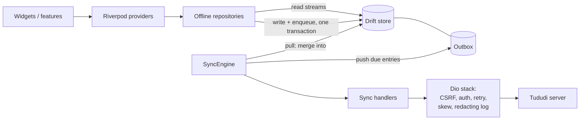

# Architecture

Tududa is offline-first: the UI only ever reads from and writes to the local Drift database.
Network I/O happens in the sync engine, never in a widget or provider.

## Layers

| Layer | Location | Responsibility |
|---|---|---|
| Features | `lib/tasks`, `projects`, `areas`, `tags`, `notes`, `inbox`, `search`, `settings`, `auth` | Screens, widgets, feature providers, domain models |
| Providers | `*/providers`, `lib/core/api/api_providers.dart` | Riverpod wiring; expose streams from repositories and the sync status |
| Repositories | `*/data` | Offline repositories: read from Drift, write to Drift and the outbox in one transaction |
| Local store | `lib/core/db` | Drift tables, DAOs, per-field dirty tracking, FTS search index |
| Sync | `lib/core/sync` | `SyncEngine`, per-entity `SyncHandler`s, outbox DAO, retry policy, field-level merge |
| API | `lib/core/api` | Dio client, DTO conversion, error mapping, interceptors |
| Session | `lib/auth/session` | Server config, credential store, session controller, silent re-login |
| Android core | `android/tududi_core` | Kotlin library shared with the Android widget: encrypted vault, API client |

## Write path

1. A repository method opens one database transaction.
2. It updates the row, marks the changed fields dirty and inserts an outbox entry.
3. The outbox insert wakes the sync engine. Entries have a short `not_before` delay so an
   action can be undone before it is sent.
4. The engine pushes due entries oldest first. A handler sends only the dirty fields (PATCH),
   resolves references to other entities at send time, and on success clears only the fields
   it sent. A field edited during the push stays dirty.

## Read and merge path

A sync cycle pulls each entity type, then pushes. For each server row:

- no local row: insert it, keeping the server snapshot as the merge base;
- clean local row: overwrite it;
- dirty local row: field-level three-way merge (base, local, server). Fields the user changed
  keep the local value unless the server changed them as well; conflicts are reported to the UI.

If the server rejects a push with 400, 404, 409 or 422, the entry is rolled back to its base
snapshot and the user is notified. Transient failures back off exponentially; after repeated
failures an entry is marked stuck until a manual sync.
Details for contributors: [`lib/core/sync/README.md`](../lib/core/sync/README.md).

## Session and API stack

- Credentials live in the Android Keystore-backed vault, never in source, `BuildConfig` or logs.
- Mutating requests carry `x-csrf-token`, fetched from `GET /csrf-token` and refreshed once on
  a CSRF 403.
- A 401 triggers one silent re-login; if that fails the engine enters a signed-out phase and
  keeps all pending entries.
- Debug logging goes through a redacting interceptor.
